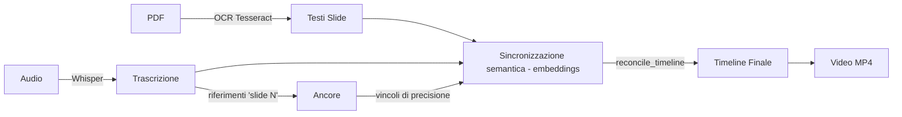

# Slide2Video 🎬

[](https://github.com/riefolog-cyber/sync-video/actions/workflows/ci.yml)

Sincronizza automaticamente una presentazione PDF con un podcast audio e genera un video in cui ogni slide appare al momento giusto.

**Pipeline:** PDF → OCR → Trascrizione (Whisper) → Ancore "slide N" → Sincronizzazione semantica (embeddings) → Video MP4



---

## 🚀 Avvio rapido

```bash
# Opzione 1: Doppio click su genera_video.bat

# Opzione 2: Terminale
genera_video.bat

# Il bootstrap installa automaticamente TUTTE le dipendenze:
# pacchetti pip, Tesseract OCR, ffmpeg, modelli ML
# Su Windows installa anche Python, se sul PC non c'e' ne' uno
# (via winget: serve Windows 10 1809 o Windows 11), scegliendo la
# versione in base all'architettura: 3.12 su x86-64, 3.11 su ARM64.
# Output: video_finale.mp4
#
# Installa/aggiorna anche i pacchetti sotto la versione minima richiesta: un
# pacchetto troppo vecchio puo' far fallire l'import di un ALTRO pacchetto (es.
# numpy vecchio -> pandas non si importa -> pytesseract sembra guasto).
```

> ## 🪟 Funziona solo su Windows
>
> L'avvio automatico, gli script e la scelta del motore di trascrizione sono
> pensati per **Windows 10/11**. È l'unica piattaforma verificata: scarichi lo
> ZIP, fai doppio clic su `genera_video.bat`, e il PC si prepara da solo.
>
> **Su macOS non funziona**, e non è una questione di configurazione: i `.bat`
> non esistono, Python va installato a mano, serve Homebrew per Tesseract e
> ffmpeg, e soprattutto **sui Mac con chip Apple non c'è alcun motore di
> trascrizione** — `faster-whisper` non pubblica wheel per quella CPU e
> OpenVINO non esiste su macOS. Manca il pezzo centrale del programma.
>
> **Su Linux** non è supportato per lo stesso motivo.

> Su Windows non devi installare niente a mano: scarichi lo ZIP, fai doppio
> clic su `genera_video.bat`, e il programma prepara il PC da sé.
> Dettagli e come disattivare l'installazione automatica:
> [docs/setup.md](docs/setup.md#primo-avvio-automatico).

### 🔒 Ambiente dedicato (consigliato)

Il programma funziona anche col Python di sistema, ma quel Python è **condiviso con tutti gli altri programmi del PC**: un `pip install` fatto altrove può cambiare una versione e impedire l'avvio. Misurato il 16/09/2026: un'altra installazione ha messo `numpy 1.24.3` e `pandas` (dipendenza di pytesseract) non si importava più, quindi la pipeline non partiva nemmeno per le fasi che non usano l'OCR.

```bash
# Una volta sola: crea la cartella .venv e installa i pacchetti del progetto
crea_venv.bat          # Windows
```

> Il progetto è **solo Windows**: non c'è uno script `.sh` equivalente.

Da quel momento `genera_video.bat`, `aggiornamenti.bat`, `prova.bat`, `controlli.bat` e `check_embedding_models.bat` usano `.venv` da soli: non serve cambiare nulla a mano.

| Comando | Cosa fa |
|---|---|
| `crea_venv.bat` | Crea `.venv` (o completa i pacchetti mancanti se esiste) |
| `crea_venv.bat --ricrea` | Cancella `.venv` e la ricrea da zero |
| `set SYNC_VIDEO_NO_VENV=1` | Usa il Python di sistema, ignorando `.venv` (Windows) |

La venv **riusa i modelli già scaricati** (cartella `.cache` e cache di HuggingFace): non riscarica nulla, e la prima run resta veloce. Dentro `.venv` `pip check` non segnala conflitti; nel Python globale ne convivono diversi (pacchetti di altri progetti).

> **Cambio di PC / hardware**: il motore di trascrizione **non viene mai
> ripreso da disco**. In `.cache/machine_setup.json` si salvano solo i *fatti*
> hardware (impronta della macchina + lista delle GPU), che sono lenti da
> ottenere ma stabili; la *decisione* ("usa CUDA", "usa OpenVINO") è ricalcolata
> a ogni run e poi **validata contro il runtime reale** (il device esiste? il
> pacchetto è installato? il modello c'è?). Se non regge, ripiega su CPU
> avvisando. Perché: la decisione dipende da fatti che cambiano (che pacchetti
> sono installati, che device espone il runtime *adesso*), mentre l'hardware no.
> Persistendola, copiare la cartella da un PC con GPU NVIDIA a uno senza chiudeva
> la run con `CUDA driver version is insufficient` **dopo** OCR e rendering, senza
> che nulla avesse notato che la GPU non c'era più.
>
> Come difesa aggiuntiva, se faster-whisper non riesce a costruire il modello su
> CUDA, ripiega da solo su CPU (int8) e la pipeline prosegue; se però avevi
> chiesto `--whisper-device cuda` esplicitamente, non lo fa di nascosto e ti
> avvisa. `.env` resta per gli override espliciti tuoi (che hanno precedenza);
> se cambi GPU restando sullo stesso sistema, `--force-setup` rileva di nuovo.

> **Precisione assoluta**: il programma non distribuisce mai le slide uniformemente. La timeline viene costruita dal **solo** allineamento semantico (embeddings offline, senza LLM), vincolato dai riferimenti espliciti "slide N" nella trascrizione. Se non è generabile → **interruzione con avviso**.

### 🔀 Flussi supportati

| Flusso | Segnale nell'audio | Esempio |
|---|---|---|
| `slide-audio` | *"Passiamo alla slide 3"* | Speaker nominano il numero slide: in cifre (*"slide 3"*), in cardinali (*"slide tre"*) o in ordinali (*"la terza diapositiva"*, *"la sesta slide"*) |
| `audio-slide` | *"Passiamo al blocco successivo"* | Dibattito, poi slide generate dopo |

Override manuale: `python src/main.py --flow audio-slide` (oppure `--flow slide-audio`)

> **Auto-detection automatica**: il sistema sceglie da solo fra i due flussi.
> Se il podcast segue i vincoli del prompt NotebookLM (`slide N` o
> `blocco successivo`) usa il flusso corrispondente e rispetta le ancore.
>
> ⛔ **Un audio senza riferimenti riconoscibili non è supportato.** Se la
> trascrizione non contiene né "slide N" né "blocco successivo" non è
> sincronizzabile: la pipeline si **interrompe** con un errore chiaro che chiede
> di rigenerare il podcast annunciando le slide.

### 📝 Prompt NotebookLM (come generare presentazione e podcast)

Un solo processo di input:

| Prompt | Flusso | Quando usarlo |
|---|---|---|
| [`PROMPT_PRESENTAZIONE (PREDEFINITO).md`](<PROMPT_PRESENTAZIONE (PREDEFINITO).md>) | deck → podcast con ancore `slide N` | Confini **misurati** (è lo speaker a dichiarare il tempo). Podcast più strutturato. Fragile a un errore operativo: se il deck cambia dopo il podcast, le ancore puntano a pagine che non esistono più |

Il prompt richiede che ogni pagina abbia una sezione di parlato **sviluppata**:
una sezione che si limita a elencare produce una pagina che nel video scorre
veloce (vedi `starved_slides` nel report).

**Il prompt.** Contiene tutto quello che serve perché il video sia
sincronizzato, più il tono del dibattito. Non chiede più l'elemento visivo per
pagina: la scelta grafica resta a NotebookLM. Il testo decorativo fuori corpo
però pesa ancora sull'OCR, che legge tutto ciò che appare sulla pagina e
diluisce il segnale. Le regole protettive sono sorvegliate da `test_prompts.py`:
se una frase sparisce dal file, i test falliscono; se la si toglie di proposito,
va registrata in `REGOLE_RIMOSSE` con il motivo, e da lì il test verifica che non
rientri.


### ✅ Ricetta validata (5 run verdi consecutive)

Procedura congelata: deck da 12–15 slide generato dal prompt, **presentazione come UNICA fonte** per il podcast, annunci `slide N` su tutte le transizioni, sezioni da 45s in su. Gate `--min-anchor-coverage` (default 50%) attivo in `genera_video.bat`.

| Run | Slide | Ancore | Durata min | Fiducia motore | Frame-check | Dubbi manuali |
|---|---|---|---|---|---|---|
| 1 | 12 | 11/11 | 45s | 0.74 alta | 12/12 | 2 (non allarmi) |
| 2 | 15 | 13/14 | 58s | 0.62 alta | 15/15 | 2 (non allarmi) |
| 3 | 14 | 12/13 | 37s | 0.53 alta | 14/14 | 2 (non allarmi) |
| 4 | 15 | 13/14 | 58s | 0.79 alta | 15/15 | **nessuno** |
| 5 | 15 | 11/14 | 45s | 0.65 alta | 15/15 | **nessuno** |

Se i materiali seguono le regole (fonte unica, tutte le pagine annunciate, sezioni sviluppate), il risultato si ripete: non modificare prompt né soglie senza rieseguire `python -m unittest test_prompts test_sync`.


> **Consiglio**: nominare la slide quando si cambia argomento (*"passiamo alla slide 3"*) regala ancore deterministiche ad alta precisione. Senza di esse il semantico allinea comunque per contenuto, ma per stima. Prompt NotebookLM: [`PROMPT_PRESENTAZIONE (PREDEFINITO).md`](<PROMPT_PRESENTAZIONE (PREDEFINITO).md>).
>
> ⚠️ **Il nemico non è dimenticare la slide: è richiamarla.** Se il conduttore
> torna su una pagina già trattata e ne ripete il numero (*"guarda sempre slide 3,
> applicano mercato"*), la pagina viene mostrata in ritardo e resta "appiccicata"
> alla precedente per tutto quel tempo. Misurato su un podcast reale: 3 confini su 8
> spostati di **74s, 85s e 53s**.
>
> Oggi è risolto su due livelli. **Alla fonte**, il prompt dedicato vieta i
> richiami e chiede di non ripetere mai un numero: è la soluzione vera, perché
> previene il difetto invece di correggerlo. **In difesa**, l'estrattore qualifica
> ogni menzione: distingue un conteggio quantificato (*"le 13 slide di questo
> documento"*, che va ignorato) da un riferimento vero, e fra i riferimenti sceglie
> la **prima** occorrenza, non l'ultima. Le due cose servono perché il semplice
> "prima menzione" rotolava indietro il video di oltre un minuto nel caso del
> conteggio, e su quel caso c'è un test dedicato
> (`test_early_total_slide_count_does_not_poison_real_anchor`).
>
> Se vedi `Slide richiamate più volte (richiamo ignorato...)` è un'informazione,
> non un allarme: segnala che il podcast richiama delle pagine e che il programma
> ha scelto il confine giusto ignorando il richiamo.


---

## 📚 Documentazione

Questo README copre avvio rapido e uso quotidiano. Il resto e' in [`docs/`](docs/):

| Pagina | Contenuto |
|---|---|
| [`docs/setup.md`](docs/setup.md) | Setup su un altro PC |
| [`docs/flussi.md`](docs/flussi.md) | Due flussi di lavoro (e i loro avvisi) |
| [`docs/comandi.md`](docs/comandi.md) | Comandi |
| [`docs/verifica.md`](docs/verifica.md) | Verifica post-run (analysis_sync.py) |
| [`docs/diagrammi.md`](docs/diagrammi.md) | Diagrammi (archify) |
| [`docs/struttura.md`](docs/struttura.md) | Struttura progetto |
| [`docs/funzionamento.md`](docs/funzionamento.md) | Come funziona |
| [`docs/troubleshooting.md`](docs/troubleshooting.md) | Troubleshooting |

| [`docs/sync-video-architecture.html`](docs/sync-video-architecture.html) | Diagramma architettura |

---

